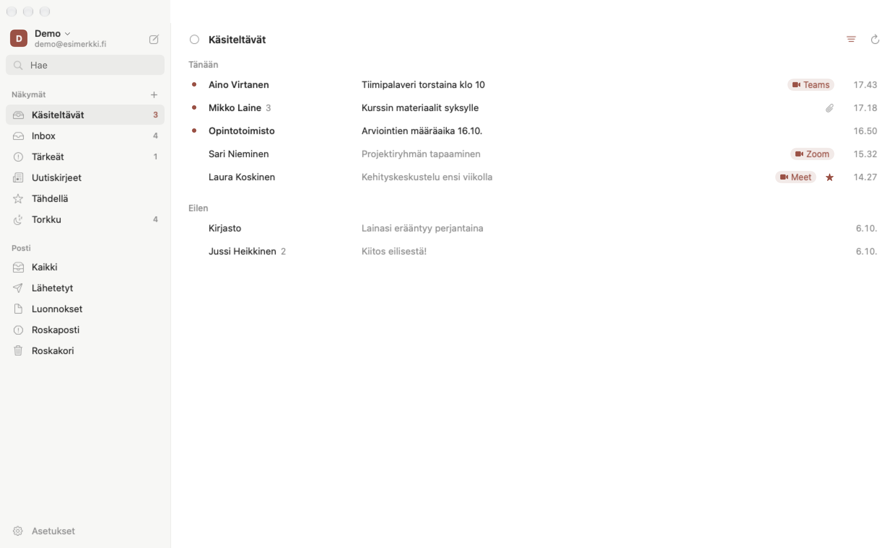
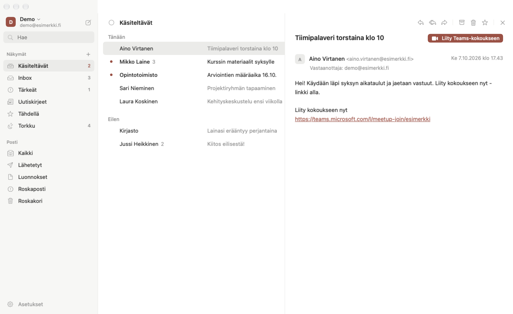
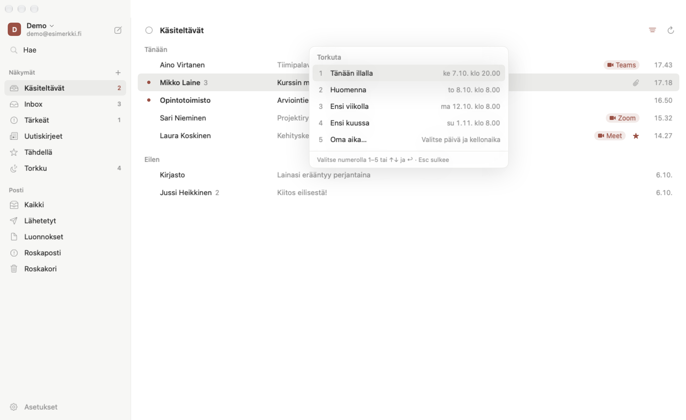
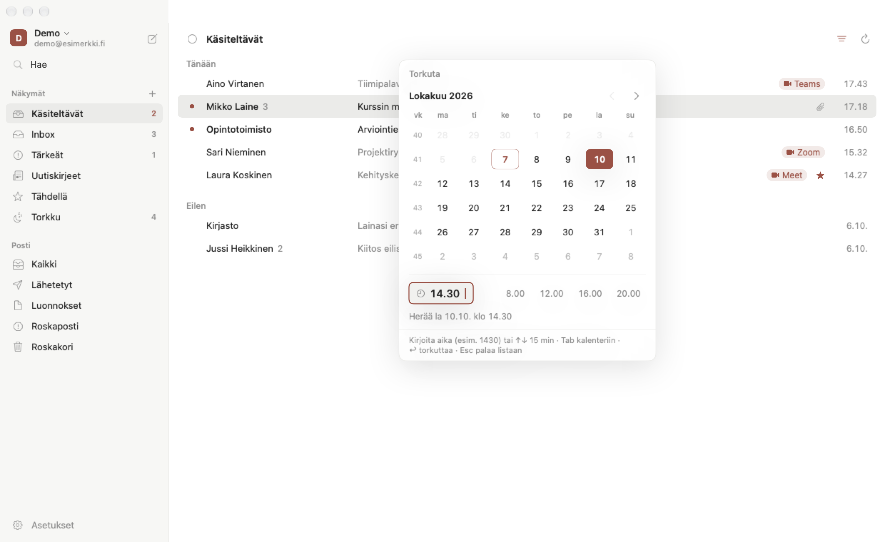
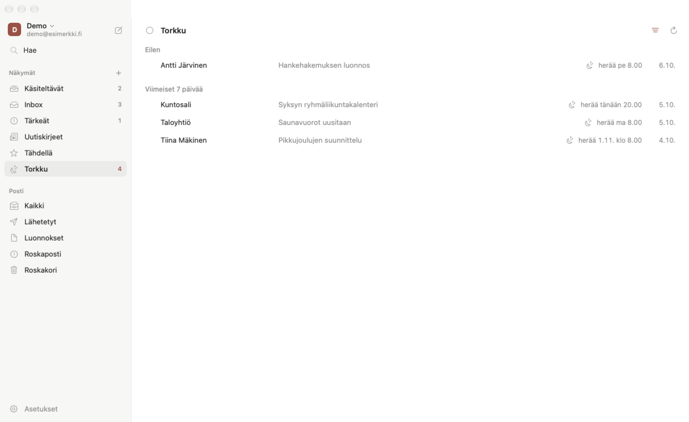
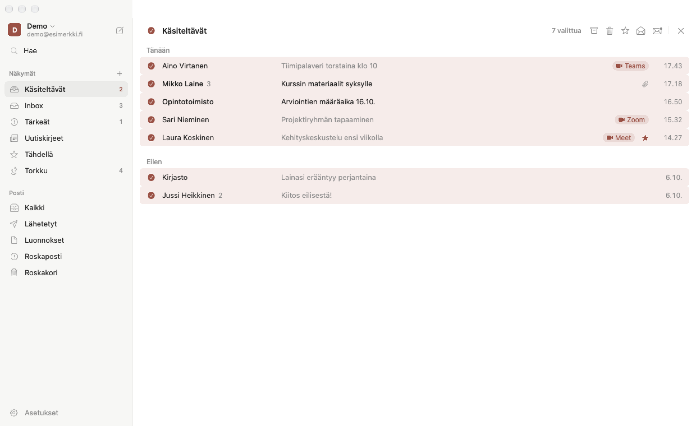
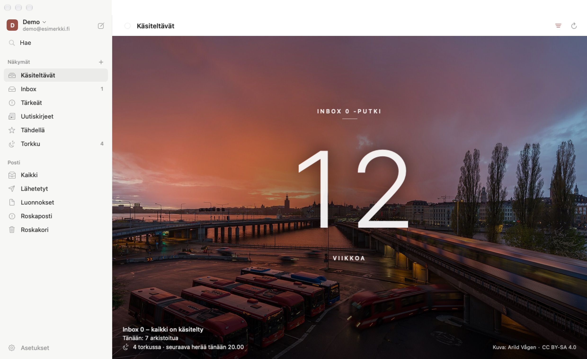
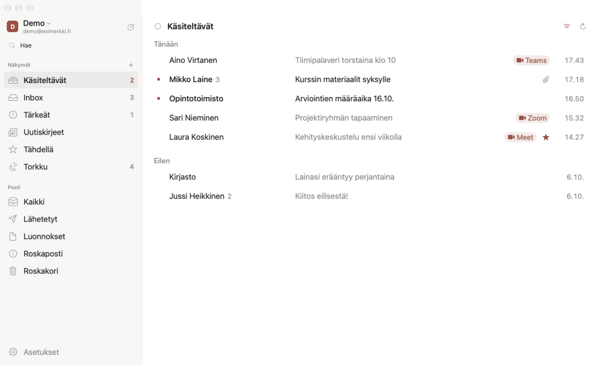

# Mak8r Mail

Rauhallinen, oma Gmail-sovellus Macille ja iPhonelle. Natiivi SwiftUI-sovellus ilman palvelinta
tai tietokantaa: posti luetaan ja käsitellään suoraan Gmail API:n kautta.

- Kolme palstaa: näkymät, ketjulista, luettava ketju
- Omat näkymät tallennettuina Gmail-hakuina
- Gmail-tyyliset pikanäppäimet
- Etäkuvat ja seurantapikselit estetty oletuksena

## Tämä forkki: seisemail

Matti Seisen oma forkki [Mak8r Mailista](https://github.com/slemppa/mak8r-mail-public). Tavoite on
näppäimistöllä käytettävä posti, jossa on Superhumanista tutut torkut ja Inbox 0, mutta ilman
tilausta ja niin, että kaikki tila on Gmailissa tunnisteina: sama torkku näkyy Gmailin
verkkoversiossa ja puhelimessa. Mac minillä pyörivä taustapalvelu herättää torkut silloinkin, kun
sovellus on kiinni. Vaiheet ja päätökset: [`CHANGELOG.md`](CHANGELOG.md). Tämä on julkinen kopio; kehitys ja
suunnitteludokumentit ovat yksityisessä repossa.

Kuvat ovat oikeasta sovelluksesta keksityllä esittelytilillä (`make screenshots`, ks. alla); yksikään
viesti tai henkilö ei ole oikea.

### Käsiteltävät ja kokouslinkit



- **Käsiteltävät** on Saapuneet ilman lajiteltuja uutiskirjeitä ja ilmoituksia. Sivupalkin luku
  kertoo lukemattomat.
- **Kokouskutsut** (Teams, Zoom, Google Meet) merkitään listaan, ja avatussa viestissä on suora
  liittymisnappi. Linkki tarkistetaan ennen avaamista, koska viestin sisältö on epäluotettavaa.



### Torkku (`h`)



- `h` avaa valikon: **Tänään illalla** (klo 20), **Huomenna** (klo 8), **Ensi viikolla**
  (seuraava maanantai klo 8), **Ensi kuussa** (seuraavan kuun 1. päivä klo 8) ja **Oma aika**.
  Numero valitsee suoraan. Klo 20 jälkeen "Tänään illalla" himmenee, mutta numerot pysyvät samoina.
- Torkku on kaksi Gmail-tunnistetta, `Torkku` ja `Torkku/<aika UTC:nä>`, joten se toimii joka
  laitteella. Ajat lasketaan Helsingin ajassa kesäaikasiirtymät huomioiden.



- **Oma aika** on sovelluksen oma kalenteri: viikot maanantaista, viikkonumerot, menneet päivät
  himmeinä. Nuolet vaihtavat päivää, kellonajan voi kirjoittaa numeroina (`8`, `830`, `1430`),
  `↑↓` siirtää vartin kerrallaan ja `↩` torkuttaa.



- **Torkku-näkymässä** jokaisella rivillä on herätysaika. Herätys tuo viestin takaisin
  Saapuneisiin lukemattomana.

### Monta viestiä kerralla



- **Valitse kaikki** -ruutu (`⌘A`) ja `x` yksittäiselle riville. Isot arkistoinnit menevät jonoon
  ("Arkistoidaan 140 ketjua…"), joka pysyy Gmailin minuuttikiintiössä ja käyttää `batchModify`-kutsua.

### Inbox 0



- Kun käsiteltävät loppuvat, listan tilalle tulee **päivän kuva** Wikimedia Commonsista tai yksi
  sovelluksen mukana tulevista kahdeksasta luontokuvasta (toimii myös ilman verkkoa). Kuvan
  tekijä ja lisenssi näkyvät oikeassa alakulmassa; tiedot ovat tiedostossa
  [`Resources/InboxZero/credits.json`](Resources/InboxZero/credits.json).
- Keskellä on **Inbox 0 -putki**: peräkkäiset viikot, joina Saapuneet on ollut tyhjä ainakin kerran.
  Alakulmassa ovat päivän arkistoinnit ja torkut sekä seuraava herätys.

### Tekstin koko



- Tekstin koko 85–200 % (`⌘+`, `⌘−`, `⌘0` tai Asetukset → Yleiset). Koko koskee listaa,
  sivupalkkia, lukunäkymää ja kirjoitusikkunaa.

### Taustapalvelu Mac minillä

`mak8r-daemon` on launchd-palvelu, joka herättää torkut minuutin välein ja siivoaa vanhentuneet
aikatunnisteet. Se myös lajittelee uutiskirjeet, ilmoitukset, kuitit ja ihmisiltä tulleet viestit
tunnisteisiin, ensin varjotilassa (päätökset vain lokiin). Kirjautumisen vanhenemisesta tulee
muistutus Saapuneisiin. Esimerkki:

```
$ mak8r-daemon status
Daemon käynnissä (pid 42212, käännös 121, käynnistetty ke 7.10. klo 16.33).
Tilat: herätys live, lajittelu shadow (varjotila: vain lokiin)

demo@esimerkki.fi: käynnissä
  Kirjautuminen voimassa ke 14.10. klo 16.34 asti
  tänään: herätetty 3, peruttu 0, siivottu 2, luokiteltu 41, periytetty 6, ei osumaa 12
```

Asennus: `make daemon-install` ja `make daemon-login EMAIL=…`.

### Muuta

- **Gmail-kiintiö**: lukuvälimuisti, kiintiöbudjetti ja hallittu odotus 429/403-vastauksissa;
  "Viestien lataus epäonnistui" -virheet poistuivat.
- **Ääkköset**: väärin merkityt merkistöt korjataan viestikohtaisesti (ennen yksi virheellinen tavu
  rikkoi koko viestin).
- **Liitteet**: PDF:t ja muut liitteet aukeavat esikatseluun ja tallentuvat.
- **Valikkopalkki**: lukemattomat ja torkussa olevat yhdessä kuvakkeessa; torkkurivi avaa
  Torkku-näkymän.
- **Kielenhuolto**: koko käyttöliittymän suomi on käyty läpi (lukusanat, toimintojen nimet,
  macOS:n omat asetusnimet).

### Kuvien päivittäminen

```bash
make screenshots
```

Käynnistää sovelluksen omalla bundle-tunnisteella ja väliaikaisella datakansiolla, kirjautuu
keksittyyn esittelytiliin (`DemoGmail`, ei verkkoa, ei Keychainia), käy näkymät läpi ja tallentaa
kuvat kansioon `docs/images/`. Ikkuna näkyy noin puolitoista minuuttia, koska kokousmerkkien haku
alkaa minuutin kuluttua käynnistyksestä.

## Miten tämä toimii

Valmista asennuspakettia ei ole. Jokainen käyttäjä kääntää sovelluksen itse ja käyttää
**omaa Google Cloud -projektiaan**. Postisi kulkee vain oman koneesi ja Googlen välillä;
kenelläkään muulla (ei edes tämän koodin tekijällä) ei ole pääsyä siihen. Kirjautumistiedot
tallentuvat koneesi Keychainiin.

## Mitä tarvitset

- Mac, jossa **macOS 26** tai uudempi
- **Xcode 27** (App Storesta). Avaa se kerran asennuksen jälkeen, jotta komentorivityökalut
  asentuvat.
- Google-tili, jonka postia haluat lukea
- iPhone-versioon lisäksi [XcodeGen](https://github.com/yonaskolb/XcodeGen) ja Apple ID
  (maksullinen Apple Developer -tili ei ole pakollinen, ks. alla)

## Käyttöönotto Macilla

### 0. Lataa koodi

```sh
git clone https://github.com/slemppa/mak8r-mail-public.git mak8r-mail
cd mak8r-mail
```

### 1. Google Cloud -projekti (kerran, noin 10 min)

1. Avaa [Google Cloud Console](https://console.cloud.google.com/) ja luo uusi
   projekti, esimerkiksi `mak8r-mail`.
2. **APIs & Services → Library** → hae *Gmail API* → **Enable**.
3. **Google Auth Platform** (OAuth consent screen):
   - **Branding**: sovelluksen nimi `Mak8r Mail` ja oma sähköpostisi.
     Muut kentät voi jättää tyhjiksi.
   - **Audience**: tyyppi *External*, lisää oma tilisi testikäyttäjäksi. Tämä forkki pitää sovelluksen *Testing*-tilassa (oma käyttö, ei tietosuojaselostetta), joten kirjautuminen vanhenee 7 päivän välein; Mac minin daemon muistuttaa siitä etukäteen.
   - **Data access**: lisää scope `https://www.googleapis.com/auth/gmail.modify`.
4. **Clients → Create client** → tyyppi **Desktop app** → luo. Kopioi client ID
   ja client secret talteen.

Koska sovellusta ei ole lähetetty Googlen tarkastettavaksi, ensimmäisellä
kirjautumisella näkyy varoitus vahvistamattomasta sovelluksesta. Valitse
*Advanced → Go to Mak8r Mail (unsafe)*. Tämä tehdään vain kerran.

### 2. Tunnukset

```sh
cp Config/Secrets.example.xcconfig Config/Secrets.xcconfig
```

Avaa `Config/Secrets.xcconfig` ja korvaa `GOOGLE_CLIENT_ID` ja `GOOGLE_CLIENT_SECRET`
vaiheen 1 arvoilla. Macia varten muita rivejä ei tarvitse muuttaa. Tiedosto on
`.gitignore`-listalla, joten tunnukset eivät päädy gittiin.

### 3. Käännös ja asennus

```sh
make test      # ajaa testit
make run       # kokoaa build/Mak8r Mail.app ja käynnistää sen
make install   # asentaa /Applications/Mak8r Mail.app
```

Koodia voi muokata Xcodessa: `open Package.swift`.

Käynnistä sovellus ja kirjaudu Google-tililläsi. Selain aukeaa, ja Google varoittaa
vahvistamattomasta sovelluksesta (ks. vaihe 1). Lisää tilejä voi ottaa käyttöön
asetuksista.

Sovellus allekirjoitetaan vain paikallisesti, joten macOS saattaa uuden
käännöksen jälkeen kysyä kerran lupaa Keychainin käyttöön. Valitse *Always Allow*.
Jos koneessa ei ole Apple Development -varmennetta (Xcode → Settings → Accounts →
*Manage Certificates*), allekirjoitus vaihtuu joka käännöksellä ja joudut kirjautumaan
uudelleen jokaisen `make install`in jälkeen. Varmenteen saa ilmaiseksi millä tahansa
Apple ID:llä.

### Päivittäminen

```sh
git pull
make install
```

### Ongelmia?

| Oire | Syy ja korjaus |
|---|---|
| `error 400: redirect_uri_mismatch` tai `invalid_client` | Client on väärää tyyppiä tai ID/secret on kopioitu väärin. Mac tarvitsee tyypin **Desktop app**. |
| `Access blocked: ... has not completed the Google verification process` | Tiliäsi ei ole lisätty testikäyttäjäksi (**Audience → Test users**). |
| Kirjautuminen pyytää lupia uudestaan viikon välein | Odotettua: sovellus on tarkoituksella *Testing*-tilassa. Kirjaudu uudelleen; daemon: `mak8r-daemon login <osoite>`. |
| Gmail API -virhe 403 `accessNotConfigured` / `SERVICE_DISABLED` | Gmail API:a ei ole otettu käyttöön projektissa (vaihe 1, kohta 2). |
| Gmail API -virhe 403 "Quota exceeded … Units per minute per user" (`rateLimitExceeded`) | Käyttäjäkohtainen minuuttikiintiö täyttyi (uusi projekti 6 000, `seisemail` 15 000). Sovellus odottaa ja yrittää uudelleen; ks. `docs/gmail-quota.md`. |
| `swift: command not found` tai käännösvirhe Swift-versiosta | Asenna Xcode 27 ja aja `sudo xcode-select -s /Applications/Xcode.app`. |

## iPhone

Sama logiikka (`MailCore`) ja sovellusmalli (`AppModel`) kuin Macissa; iPhonella on oma
SwiftUI-käyttöliittymä kansiossa `iOS/`. Vaatii iOS 26:n.

### 1. Google Cloud: iOS-asiakas

Keksi ensin sovellukselle oma bundle ID, esimerkiksi `com.sukunimi.mail.ios`. Sen pitää
olla maailmanlaajuisesti yksilöllinen, joten valmiina olevaa `fi.mak8r.mail.ios`:ää et
voi käyttää.

Samaan Google Cloud -projektiin kuin Mac-versio: **Clients → Create client** → tyyppi
**iOS**, bundle ID se, jonka juuri keksit. iOS-asiakkaalla ei ole client secretiä.
Täytä tiedostoon `Config/Secrets.xcconfig`:

```
GOOGLE_IOS_CLIENT_ID = 1234567890-xyz.apps.googleusercontent.com
DEVELOPMENT_TEAM = ABCDE12345
IOS_BUNDLE_ID = com.sukunimi.mail.ios
```

`DEVELOPMENT_TEAM` on Apple-tiimisi tunnus: maksullisella tilillä developer.apple.com →
Membership; ilmaisella Apple ID:llä se näkyy Xcodessa kohdassa *Signing & Capabilities*
(Personal Team), kun lisäät Apple ID:n Xcoden asetuksiin.

### 2. Käännös ja asennus

```sh
brew install xcodegen   # kerran
make ios                # luo iOS/Mak8rMail.xcodeproj ja avaa sen Xcodessa
```

Kytke iPhone kaapelilla (tai samaan verkkoon), valitse se Xcodessa kohteeksi ja paina ▶.
Ensimmäisellä kerralla iPhonessa pitää sallia kehittäjätila (*Asetukset → Tietosuoja ja
turvallisuus → Kehittäjätila*). Maksullisella Apple Developer -tilillä asennus on
voimassa vuoden, ilmaisella Apple ID:llä vain 7 päivää (sen jälkeen asennetaan
uudelleen samalla tavalla). TestFlightin kautta (*Product → Archive → Distribute*) päivitykset
tulevat ilman kaapelia.

Xcode-projekti luodaan aina `project.yml`:stä, eikä sitä viedä gitiin. Aja `make ios`
uudelleen, kun lisäät tiedostoja.

### Erot Mac-versioon

- Pyyhkäisyt: vasemmalle arkistoi / roskakoriin, oikealle luettu / tähti. *Valitse*
  valitsee useita.
- Tilit, näkymät ja asetukset ovat vasemman yläkulman valikossa.
- Liitteet aukeavat Quick Lookissa; jakopainikkeella ne tallentuvat Tiedostoihin.
- Uudet viestit tarkistetaan taustalla silloin, kun iOS sen sallii (yleensä harvemmin
  kuin kerran vartissa). Välittömiä ilmoituksia varten tarvittaisiin palvelin, jota
  sovelluksessa ei ole. Jos iOS on sulkenut sovelluksen kokonaan, ensimmäinen
  taustatarkistus vain kirjaa nykytilan eikä ilmoita.
- Peruutusviivettä odottavat viestit lähetetään heti, kun sovellus siirtyy taustalle.

## Pikanäppäimet

Toimivat pääikkunassa, kun et kirjoita tekstikenttään. Yhden näppäimen pikanäppäimiä voi vaihtaa kohdassa Asetukset → Pikanäppäimet.

| Näppäin | Toiminto | Näppäin | Toiminto |
|---|---|---|---|
| `j` / `k` | seuraava / edellinen ketju | `r` | vastaa |
| `↩` / `o` | avaa ketju | `a` | vastaa kaikille |
| `esc` / `u` | takaisin listaan | `f` | välitä eteenpäin |
| `e` | arkistoi | `c` | uusi viesti |
| `s` | tähti päälle/pois | `/`, `⌘F` | haku |
| `#` | roskakoriin | `⌘↩` | lähetä |
| `⇧U` | merkitse lukemattomaksi | `⌘Z` | kumoa edellinen toiminto |
| `⌥1…9` | vaihda näkymää | `⌘R` | päivitä |
| `⌘1…9` | vaihda tiliä | `x` / `⌘A` | valitse / valitse kaikki |
| `⌘N` | uusi viesti | `⌘⇧A` | lisää liite |
| `h` | torkuta | | |

## Asetukset

Asetuksissa (⌘,) ovat allekirjoitukset tileittäin (oma tai Gmailista tuotu), lähetyksen peruutus, liitevaroitus, etäkuvat, luetuksi merkitseminen, arkistoinnin jälkeinen valinta, ilmoitukset tileittäin sekä muokattavat pikanäppäimet.

## Tiedostot

| Mitä | Missä |
|---|---|
| Näkymät | `~/Library/Application Support/Mak8rMail/views-<tili>.json` |
| Asetukset | `~/Library/Application Support/Mak8rMail/settings.json` ja `settings-<tili>.json` |
| Keskeneräiset viestit | `~/Library/Application Support/Mak8rMail/drafts/` |
| Esikatsellut liitteet | `~/Library/Caches/Mak8rMail/attachments/` |
| Päivän laskuri | `~/Library/Application Support/Mak8rMail/seise-today.json` |
| Inbox 0 -viikot (putki) | `~/Library/Application Support/Mak8rMail/seise-inbox-zero-weeks.json` |
| Inbox 0 -päivän kuvat | `~/Library/Caches/Mak8rMail/inbox0/` (viikon ajan) |
| Forkin kertamigraatiot | `~/Library/Application Support/Mak8rMail/seise-migrations.json` |
| Kirjautuminen | Keychain, palvelu `fi.mak8r.mail` |

## Rakenne

- `Sources/MailCore` – logiikka (OAuth, Gmail API, MIME, tila). Kaikki testattu.
- `Sources/Mak8rMail` – Macin SwiftUI-käyttöliittymä. `AppModel`, `Theme`, `Notifier`,
  `ThreadWebView` ja `RelativeDate` ovat yhteisiä iPhonen kanssa.
- `iOS/` – iPhone-sovellus: `project.yml` (XcodeGen) ja iPhonen näkymät.
- `Tests/MailCoreTests` – Swift Testing -testit.

## Outlook-tuki (jatkokehitys)

Sovellus tukee nyt vain Gmailia, mutta rakenne on tehty niin, että toisen palvelun voi
lisätä koskematta käyttöliittymään. Microsoft 365- ja Outlook.com-tilit onnistuvat
[Microsoft Graph](https://learn.microsoft.com/graph/api/resources/mail-api-overview)
-rajapinnan kautta samalla periaatteella: suoraan omalta koneelta, ilman palvelinta.

### Missä Gmail on kiinni

| Kohta | Tiedosto | Mitä Outlookia varten tarvitaan |
|---|---|---|
| Postirajapinta | `Sources/MailCore/Gmail/GmailAPI.swift` | Protokolla `GmailAPI` on ainoa asia, jonka `MailStore`, `InboxMonitor` ja `ComposeController` näkevät. Tee sille toteutus `LiveGraphClient` (mallina `LiveGmailClient.swift`). Protokollan voi nimetä uudelleen esim. `MailAPI`:ksi. |
| Kirjautuminen | `Sources/MailCore/Auth/GoogleAuth.swift` | OAuth 2.0 + PKCE, joka toimii Microsoftilla lähes samoin. Pääosin endpointit, scopet ja client-tyyppi vaihtuvat. `LiveGmailClient` käyttää vain `AccessTokenProvider`-protokollaa, joten Microsoft-kirjautuminen voi olla oma tyyppinsä sen takana. |
| Tilin kokoaminen | `Sources/MailCore/Accounts/AccountSession.swift` (`live`) ja `Sources/Mak8rMail/AppModel.swift` (kirjautuminen, `GoogleAuth(` ja `LiveGmailClient(`) | Tilille tarvitaan tieto palveluntarjoajasta (Google/Microsoft), joka tallennetaan `AccountList`iin. Sen perusteella valitaan oikea kirjautuminen ja client. Kirjautumisnäkymään tulee toinen painike. |
| Tunnisteet | `GmailLabel` tiedostossa `Sources/MailCore/Model/Message.swift` | Gmailin tila on tunnisteita (`INBOX`, `UNREAD`, `STARRED`, `TRASH`). Graphissa vastaavat ovat kansio, `isRead`, `flag` ja *Deleted Items*. Helpointa on muuntaa ne clientissä Gmail-muotoon, jolloin muun koodin ei tarvitse tietää eroa. Esimerkiksi `modify(remove: ["INBOX"])` siirtää viestin Archive-kansioon. |
| Haut ja näkymät | `Sources/MailCore/Views/MailFilter.swift` (`query`) ja `ViewsConfigStore` | Näkymät tallennetaan Gmail-hakuina (`in:inbox is:unread from:x`). Graphin client kääntää ne `$filter`/`$search`-muotoon (KQL), tai tilakohtaiset näkymät tallennetaan neutraalissa muodossa. |
| Ketjut | `threadSummary`, `thread`, `listThreads` | Gmail palauttaa ketjuja. Graph palauttaa viestejä, joilla on `conversationId`. Ketjut kootaan ryhmittelemällä sen mukaan. |
| Lähetys | `send(raw:threadID:)` | Toimii sellaisenaan: Graph hyväksyy valmiin MIME-viestin (`POST /me/sendMail`, base64-koodattu MIME, `Content-Type: text/plain`). `MessageBuilder` voi jäädä ennalleen. |
| Allekirjoitukset | `sendAsSignatures()` | Graph ei anna Outlookin allekirjoituksia. Palauta tyhjä lista, jolloin käytetään sovelluksen omia. |

`Tests/MailCoreTests/Support/FakeGmail.swift` on muistinvarainen `GmailAPI`. Testit kannattaa
kirjoittaa samaan tapaan: `StubTransport` palauttaa nauhoitetut Graph-vastaukset
(ks. `LiveGmailClientTests.swift` ja `Fixtures/`).

### Microsoft-sovelluksen rekisteröinti

Google Cloud -projektin vastine:

1. [Azure-portaali](https://portal.azure.com/) → **Microsoft Entra ID → App registrations
   → New registration**.
2. *Supported account types*: **Accounts in any organizational directory and personal
   Microsoft accounts**, jolloin sekä työtilit että Outlook.com toimivat. Tämä vastaa
   authority-osoitetta `https://login.microsoftonline.com/common/oauth2/v2.0/`.
3. **Authentication → Add a platform → Mobile and desktop applications**, redirect URI
   `http://localhost`. Microsoft ohittaa loopback-osoitteen porttinumeron, joten
   `LoopbackReceiver`in satunnainen portti käy. Nykyinen koodi käyttää osoitetta
   `127.0.0.1`. Tarkista Microsoftin
   [redirect URI -ohjeesta](https://learn.microsoft.com/entra/identity-platform/reply-url),
   kumpi muoto rekisteröidään, ja kokeile kirjautumista ennen kuin rakennat muuta.
   iPhonelle lisätään iOS-alusta ja sen bundle ID.
4. **Allow public client flows: Yes.** Client secretiä ei tarvita, koska PKCE riittää.
5. **API permissions → Microsoft Graph → Delegated**: `Mail.ReadWrite`, `Mail.Send`,
   `User.Read` ja `offline_access` (ilman sitä ei tule refresh tokenia).
6. Client ID (*Application (client) ID*) tallennetaan tiedostoon `Secrets.xcconfig` esim.
   nimellä `MICROSOFT_CLIENT_ID`, ja se välitetään `Makefile`n ja `Info.plist.template`n
   kautta samoin kuin `GOOGLE_CLIENT_ID`.

Työpaikan Microsoft 365 -tilillä ylläpitäjä voi joutua hyväksymään sovelluksen
(*admin consent*), jos organisaatio on estänyt käyttäjiä hyväksymästä sovelluksia itse.

Huomioita:
- Microsoft vaihtaa refresh tokenin jokaisella uusinnalla. `GoogleAuth` tallentaa jo nyt
  uuden tokenin, jos vastauksessa on sellainen, joten sama logiikka käy.
- Uusien viestien tarkistus (`InboxMonitor`) toimii kyselemällä `inboxUnreadCount()`-
  ja `listThreads`-metodeilla. Graphin `delta`-kyselyt tekisivät sen kevyemmäksi, mutta
  ne eivät ole pakollisia.
- Graphin `$search` ja `$filter` eivät kaikilta osin toimi yhdessä, ja `$search`
  palauttaa korkeintaan noin 1000 tulosta. Tarkista rajoitukset ennen kuin näkymien
  hakukieli lyödään lukkoon.

## Lisenssi

MIT, ks. [LICENSE](LICENSE). Saat forkata, muokata ja jakaa vapaasti.
